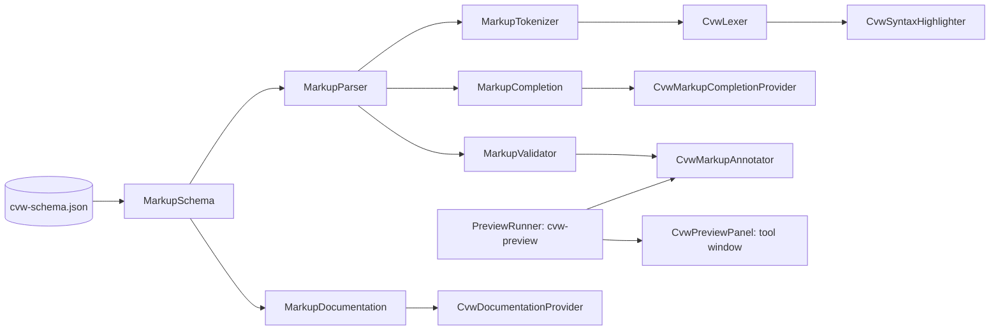

# Architecture: ConsoleMVC .cvw Plugin

## Overview

This is a JetBrains Rider plugin providing IDE support for `.cvw` (Console View) files.
It follows the standard Rider plugin dual architecture:

- **Frontend (Kotlin/IntelliJ)**: UI, file type, editor, syntax highlighting, completion, navigation
- **Backend (C#/ReSharper)**: Deep C# analysis via secondary document generation, type resolution, refactoring

## Frontend (Kotlin/IntelliJ)

### Key Files

```
src/main/kotlin/com/github/mateuszpodeszwa/consolemvc/cvwsupport/
  CvwLanguage.kt                # Language singleton ("CVW")
  CvwFileType.kt                # FileType with .cvw extension and icon
  CvwIcons.kt                   # Icon loader (/icons/cvw.svg)
  CvwBraceMatcher.kt            # Paired brace matching ({}, (), [])
  CvwCommenter.kt               # // and /* */ comment toggling
  CvwEditorTabTitleProvider.kt   # Shows "Controller/ActionView" in tabs
  CvwLiveTemplateContext.kt      # Template context for .cvw files
  CvwCreateFileAction.kt         # "New ConsoleMVC View" action in New menu

  lexer/
    CvwTokenTypes.kt             # All token type definitions
    CvwLexer.kt                  # Hand-written two-mode lexer

  parser/
    CvwParser.kt                 # Splits file into directives + code body
    CvwParserDefinition.kt       # Registers lexer, parser, file creation

  psi/
    CvwElementTypes.kt           # PSI element types (FILE, MODEL_DIRECTIVE, etc.)
    CvwFile.kt                   # PsiFile implementation

  highlighting/
    CvwSyntaxHighlighter.kt      # Token-to-color mapping
    CvwSyntaxHighlighterFactory.kt # Factory registration
    CvwColorSettingsPage.kt      # Settings > Editor > Color Scheme > CVW

  completion/
    CvwCompletionContributor.kt  # Directive + code body completion

  annotator/
    CvwAnnotator.kt              # Error/warning annotations (single-file)
    CvwModelMismatchAnnotator.kt # Cross-file model type mismatch detection
    CvwQuickFixes.kt             # Quick-fix intentions (add @model, add return)

  documentation/
    CvwDocumentationProvider.kt  # Hover docs for directives and framework types

  editor/
    CvwWordSelectionHandler.kt   # Smart Ctrl+W extend selection

  navigation/
    CvwViewLineMarkerProvider.kt # Gutter icons linking .cvw to controllers
    CvwGotoRelatedProvider.kt    # Bidirectional view <-> controller nav

  structure/
    CvwStructureViewFactory.kt   # Structure view factory
    CvwStructureViewModel.kt     # Structure view model
    CvwStructureViewElement.kt   # Tree elements (directives, nav targets)

  folding/
    CvwFoldingBuilder.kt         # Code folding for directives, braces, comments

src/main/resources/
  META-INF/plugin.xml            # Plugin descriptor with all extension registrations
  icons/cvw.svg                  # File icon (purple rounded rect with "cvw" text)
  liveTemplates/CvwTemplates.xml # Live template definitions
  fileTemplates/internal/
    ConsoleMVC View.cvw.ft       # New file template
```

### Lexer Design

The lexer (`CvwLexer`) is hand-written (not JFlex) with two modes:

1. **Directive mode** (initial state = 0):
   - Recognizes `@model` and `@using` as keywords
   - Reads their arguments as `DIRECTIVE_ARGUMENT` tokens
   - Blank lines keep us in directive mode
   - First non-directive, non-blank content switches to code mode

2. **Code mode** (state = 1):
   - Tokenizes C# code body with basic categories:
   - Keywords (C# reserved words), strings (regular, verbatim, interpolated),
     numbers, comments (line/block), identifiers, operators, individual brace types,
     other punctuation (semicolons, commas), and dots

### PSI Tree Structure

```
CvwFile (root)
  ├─ MODEL_DIRECTIVE
  │    ├─ MODEL_KEYWORD ("@model")
  │    ├─ WHITE_SPACE
  │    └─ DIRECTIVE_ARGUMENT ("Fully.Qualified.Type")
  ├─ USING_DIRECTIVE (0..N)
  │    ├─ USING_KEYWORD ("@using")
  │    ├─ WHITE_SPACE
  │    └─ DIRECTIVE_ARGUMENT ("Namespace.Name")
  └─ CODE_BODY
       └─ (all remaining C# tokens)
```

### Plugin Registration (plugin.xml)

All extensions are registered under `com.intellij.` namespace:
- `fileType`: CvwFileType
- `lang.parserDefinition`: CvwParserDefinition
- `lang.syntaxHighlighterFactory`: CvwSyntaxHighlighterFactory
- `completion.contributor`: CvwCompletionContributor
- `annotator`: CvwAnnotator, CvwModelMismatchAnnotator
- `lang.braceMatcher`: CvwBraceMatcher
- `lang.commenter`: CvwCommenter
- `liveTemplateContext`: CvwLiveTemplateContext
- `defaultLiveTemplates`: /liveTemplates/CvwTemplates
- `internalFileTemplate`: ConsoleMVC View.cvw
- `codeInsight.lineMarkerProvider`: CvwViewLineMarkerProvider
- `gotoRelatedProvider`: CvwGotoRelatedProvider
- `lang.psiStructureViewFactory`: CvwStructureViewFactory
- `editorTabTitleProvider`: CvwEditorTabTitleProvider
- `lang.foldingBuilder`: CvwFoldingBuilder
- `colorSettingsPage`: CvwColorSettingsPage

Action: `ConsoleMVC.NewCvwFile` in `NewGroup`

## C-View Markup (0.2.0)

ConsoleMVC views are C-View Markup with C# around and inside it. The plugin reads ConsoleMVC's markup schema
(`src/main/resources/schema/cvw-schema.json`), so it knows exactly the elements, attributes and values of the
framework version it was built with.



- **Parsing** (`markup/MarkupParser`): the generator's rules. At the top level and in `@{ }` the text is C#; `<tag`
  starts markup only where a statement may begin and the tag is known; inside an element every tag is markup and `@`
  starts an expression or a block of code. It never throws: views are usually half-typed.
- **Lexing** (`lexer/MarkupTokenizer`, `lexer/CvwLexer`): whether `<text` is markup depends on what came before, so
  the whole view is tokenised at once. The parse paints each character's kind (tag, attribute, value, text, `@`,
  escape, entity, comment, directive), parents first; the rest is split by `CSharpTokenizer`. Only the first token
  has the initial state, so the editor re-lexes from the start after an edit; the platform's restart check and the
  incremental highlighter test confirm the result.
- **Checks** (`annotator/CvwMarkupAnnotator`): an external annotator, off the UI thread. With `cvw-preview` and a
  trusted project it shows the generator's own diagnostics; otherwise `markup/MarkupValidator`, whose value rules
  mirror the generator's and are compared with it in `GeneratorComparisonTest`.
- **Preview** (`preview/`): `PreviewToolService` finds and runs the tool (no shell, standard input, 10 s timeout,
  8 MB limit), `PreviewPage` builds a page with a Content Security Policy that blocks scripts and keeps only the
  tool's screen, and `CvwPreviewPanel` shows it in JCEF, updated 300 ms after typing stops.

## Phase 2: Backend

### Backend File Structure

```
src/dotnet/
  CvwSupport.sln                           # .NET solution
  Plugin.props                             # SDK version (2025.1.1)
  Directory.Build.props                    # Common build properties
  CvwSupport/
    CvwSupport.csproj                      # net472 + JetBrains.Rider.SDK
    ZoneMarker.cs                          # ICvwSupportZone + ZoneMarker
    CvwProjectFileType.cs                  # .cvw file type registration
    CvwLanguage.cs                         # PSI language definition
    CvwProjectFileLanguageService.cs       # File type -> language bridge
    CvwFileParser.cs                       # Parses .cvw into directives + code body
    CvwGeneratedDocumentFactory.cs         # Generates virtual C# documents
    CvwPsiFileManager.cs                   # Solution component for document access
    CvwGeneratedDocumentService.cs         # Wires into ReSharper's secondary document pipeline
```

### Virtual Document Generation (0.2.0)

`CvwMarkupMask` classifies every character of a view (C#, markup, the `@` and C# of an expression, the `@` of a code
block) with the same rules as the frontend parser. `CvwGeneratedDocumentFactory` then writes the design-time
document:

```text
usings (the generator's defaults, then @using, mapped)
namespace {Root}[.Areas.{Area}].Views.{Folder}.DesignTime     the generator's namespace, plus .DesignTime
class {View} : ConsoleView<T> | ConsolePartialView<T> | ConsoleLayoutView
    @inject Type Name                → public Type Name { get; set; }   (mapped)
    Render(T Model) / RenderHeader()
        C#                           → copied, mapped
        markup, comments, directives → spaces (newlines kept)
        @expression                  → _ = expression;                   (expression mapped)
        return default!;             (pages without a return of their own: a <menu> returns, and is markup here)
```

`CvwSupport.Tests` compiles every template view's document against the ConsoleMVC.Framework package, runs
ConsoleMVC's real source generator on the same views and checks the namespace, base class and model agree and that
both compile together.

### Virtual Document Generation (0.1.0)

The key insight: ReSharper analyzes C# code. A `.cvw` file is NOT C#, but its
code body IS C# that will be placed inside a method body. So we create an
in-memory C# document that wraps the code body exactly as the source generator would:

```csharp
// Original .cvw:
@model MyApp.Models.HomeViewModel
@using System.Globalization
Console.WriteLine(Model.Title);
return NavigationResult.Quit();

// Generated virtual C# document:
using ConsoleMVC.Mvc;
using System.Globalization;
namespace MyApp.Views.Home {
  public class IndexView : ConsoleView<MyApp.Models.HomeViewModel> {
    public override NavigationResult Render(MyApp.Models.HomeViewModel Model) {
      Console.WriteLine(Model.Title);
      return NavigationResult.Quit();
    }
  }
}
```

A **range map** tracks character offsets so errors/completions in the generated
document map back to correct positions in the original `.cvw` file.

### Secondary Document Service Wiring

`CvwGeneratedDocumentService` extends `GeneratedDocumentServiceBase` (from `JetBrains.ReSharper.Psi.Web.Generation`)
and is registered via `[GeneratedDocumentService(typeof(CvwProjectFileType))]`. This is the same mechanism
Razor uses for `.cshtml` files. When ReSharper opens a `.cvw` file:

1. The service's `Generate()` method is called with the primary file info
2. It uses `CvwGeneratedDocumentFactory` to create the virtual C# document
3. A `RangeTranslatorWithGeneratedRangeMap` maps typed `TreeTextRange<Generated>` / `TreeTextRange<Original>` offsets
4. The result is returned as a `SecondaryDocumentGenerationResult` with C# language type
5. ReSharper's C# engine analyzes the generated document
6. Errors, completions, and navigation are projected back via the range map

### What's Left for Backend

The secondary document generation pipeline is wired. What remains:
1. Verify end-to-end in a running Rider instance with a real ConsoleMVC project

### Build System

- **Frontend**: Gradle with `intellij-platform-gradle-plugin` 2.14.0, Kotlin JVM 2.1.20, JDK 21
- **Backend**: `dotnet build` via Gradle `buildBackend` task, net472, JetBrains.Rider.SDK 2025.1.1
- **Integration**: `PrepareSandboxTask` copies backend DLLs to `{plugin}/dotnet/` in the sandbox
- Target: Rider 2025.1+ (sinceBuild = 251)
- Plugin ID: `com.github.mateuszpodeszwa.consolemvc.cvwsupport`
