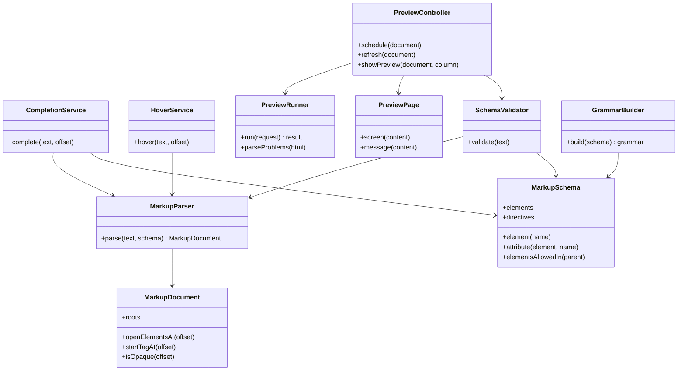

# Design: the VS Code extension

| | |
|---|---|
| **Author** | Mateusz Podeszwa |
| **Status** | Implemented in 0.1.0 |
| **Code** | [`vscode/`](../vscode) |
| **Depends on** | ConsoleMVC 1.34: `schema/cvw-schema.json` and the `cvw-preview` tool ([design](https://github.com/MateuszPodeszwa/ConsoleMVC/blob/main/docs/design/editor-support.md)) |

## 1. Goals

- Highlighting, completion, hover documentation and checks for C-View Markup in `.cvw` views.
- A live preview drawn by ConsoleMVC's real rendering engine.
- Nothing about the markup written by hand: elements, attributes and values come from the framework's schema, and the
  checks come from the generator itself when the tool is installed.
- Plain JavaScript with no runtime dependencies, so the extension is small (about 60 KB) and starts quickly.

## 2. Structure

Every part except `extension.js` and `PreviewController` is free of the VS Code API, so it is tested with plain
`node --test`.



| Folder | Contents |
|---|---|
| `src/schema` | `MarkupSchema`: the schema file with lookups, and which elements may go where |
| `src/markup` | `MarkupParser` and `MarkupDocument`: a forgiving parser for half-typed views |
| `src/language` | `CompletionService`, `HoverService`, `SchemaValidator`, `Documentation`, `ProblemRange` |
| `src/preview` | `PreviewRunner` (runs the tool), `PreviewPage` (the panel's HTML), `ToolLocator`, `PreviewController` |
| `src/grammar` | `GrammarBuilder` and `LanguageConfigurationBuilder`, run by `scripts/build-grammar.js` |
| `schema/` | A copy of ConsoleMVC's `schema/cvw-schema.json` (`npm run sync-schema -- <ConsoleMVC checkout>`) |

## 3. Parsing

The parser follows the generator's rules closely enough for editing, and never throws:

```text
code(stopAtBrace):  skip whitespace, directive lines, comments, strings
                    '<' + known tag where a statement may begin (after ; { } : or at the start) → element
                    '{' depth++; '}' at depth 0 and stopAtBrace → return
element:            '<' name attributes ('/>' | '>' content '</name>')
attribute value:    "…" or '…', where @( … ) and @Name["…"] may contain quotes
content:            '</name' → close, or return to the ancestor that has that name
                    '<' name → child element (known or not)
                    '@{' → code(true); '@if (…) { … } else …' → code(true) per block
                    '@expr', '@(…)', '@@' → text; '@*…*@' → comment; the @ of an e-mail address → text
```

Completion asks the parsed document where the cursor is: inside a start tag (attribute names), inside an attribute's
quotes (values), after `<` (the elements allowed in the innermost open element) or `</` (its closing tag), or after
`@` (directives at the top level, code constructs anywhere).

## 4. Checks

```text
on change (debounced, consolemvc.preview.delay):
    if the folder is trusted and the view is a file (or unsaved) and cvw-preview runs:
        problems ← the tool's diagnostics (the generator's own CVWxxx)
    else:
        problems ← SchemaValidator: unknown elements and attributes, placement, required attributes,
                   values (choice, boolean, integer range, number, number list, colour, length, date, route),
                   text directly in elements that hold only elements (CVW110), option rules (CVW109),
                   unclosed elements and missing quotes
```

`scripts/compare-with-generator.js` checks over 7,000 generated views with both and lists any disagreement; there is
none for the schema of ConsoleMVC 1.34.

## 5. The preview

```mermaid
sequenceDiagram
    participant E as Editor
    participant C as PreviewController
    participant R as PreviewRunner
    participant T as cvw-preview
    participant P as Webview panel
    E->>C: change (debounced)
    C->>R: run(file, text, width, theme)
    R->>T: spawn without a shell; text on stdin
    T-->>R: <pre class="cvw-screen"> + <ul class="cvw-problems">
    R-->>C: html, problems
    C->>E: diagnostics
    C->>P: PreviewPage.screen(html, problems)
```

- `ToolLocator` tries the configured command, and for the default also `~/.dotnet/tools/cvw-preview`, which is often
  missing from the PATH of an editor started from the desktop.
- Runs are numbered per view; a result older than the newest run is dropped, so a slow run never replaces a newer one.
- When a run fails after a good one, the last screen stays, marked as old, with the error under it.

## 6. Security

- `consolemvc.preview.path` has `machine` scope: only user settings can set it, so a folder cannot make the extension
  run another program. In untrusted folders the tool never runs.
- The tool is spawned without a shell, with its arguments as a list; the view goes through standard input. A run is
  stopped after 10 seconds, and output over 8 MB is refused.
- The panel has `enableScripts: false`, no local resource roots, and a Content Security Policy of
  `default-src 'none'; style-src 'unsafe-inline'`. `PreviewPage.onlyScreen` keeps only the tool's `<pre>` with its
  `<span style>` runs and escapes any other tag, and problem messages are escaped.

## 7. Highlighting

`GrammarBuilder` writes `syntaxes/cvw.tmLanguage.json` from the schema: one rule per element (`<name …>` to
`</name>`, or `<name … />` for void elements), so a tag of another element cannot end it. C# around the markup uses the
C# grammar's expressions and comments, but braces are the grammar's own, so markup inside `if (…) { … }` stays markup.
A test checks that the checked-in grammar matches the schema.

## 8. Testing

| Suite | What it covers |
|---|---|
| `npm test` (node:test) | Schema lookups; the parser on the template's views and on broken text; completion, hover and checks; the runner with a fake tool (drawn, failing, garbage, too large, missing); the panel's HTML and its escaping; the controller with a fake VS Code API (fallbacks, untrusted folders, debouncing, stale screens); the grammar tokenised by vscode-textmate with Oniguruma; the manifest and snippets |
| `npm run test:integration` | The extension in a real VS Code: language, completion, hovers, diagnostics while typing, the preview command and block comments |
| `scripts/compare-with-generator.js` | The schema checks against the real generator |

Set `CSHARP_GRAMMAR` to VS Code's `csharp.tmLanguage.json` to run the grammar tests with the real C# grammar instead of
the stand-in, and `CVW_PREVIEW` to a real `cvw-preview` for the integration tests.
